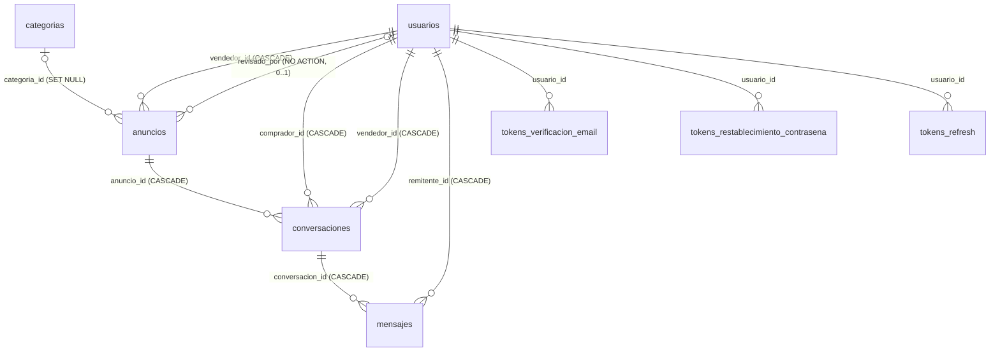

# Database Design Document — Uni Market (marketplace universitario)

Documento autónomo: describe por completo el esquema de datos de **Uni Market**, el marketplace de compraventa entre estudiantes de campus universitario. Ningún conocimiento externo es necesario para leerlo.

| Campo | Valor |
|---|---|
| Estado | Aprobado — implementado en V1–V3 y verificado contra PostgreSQL 18 |
| Última actualización | 2026-10-14 |
| Fecha | 2026-10-09 |
| Motor / migraciones | PostgreSQL 18 (última versión mayor vigente; PostgreSQL no publica ediciones "LTS": soporte de 5 años por versión mayor); Flyway (versionadas, forward-only) |
| Extensión requerida | `pg_trgm` (búsqueda difusa por trigram) |
## 1. Database Overview

**Propósito.** Base de datos de un marketplace universitario: estudiantes publican anuncios (con revisión previa), exploran un catálogo público y negocian por chat comprador–vendedor por anuncio; la base persiste identidad, catálogo, moderación, conversaciones y tokens de sesión. **Alcance: 8 tablas** — negocio (5): `usuarios`, `categorias`, `anuncios`, `conversaciones`, `mensajes`; tokens de sesión (3): `tokens_verificacion_email`, `tokens_restablecimiento_contrasena`, `tokens_refresh`.

**Principios de diseño.**

| Principio | Descripción |
|---|---|
| Identificadores | Tablas y columnas en `snake_case` (el casing `camelCase` pertenece al wire de la API, no a la BD). PK `uuid DEFAULT gen_random_uuid()` en todas las tablas excepto `categorias.id` (`serial`); sin extensión `uuid-ossp`. |
| Identidad única | `usuarios` es la ÚNICA tabla de identidad: perfil, credenciales y rol viven en ella (sin tabla de perfil ni segunda columna de identidad). `usuarios.id` coincide con el `sub` del JWT, de modo que los predicados de negocio resuelven sin JOIN. |
| Soft-delete selectivo | Solo `usuarios` tiene soft-delete (`fecha_eliminacion`). `anuncios` usa `estado='eliminado'`; `categorias` y `conversaciones`/`mensajes` conservan borrado físico. |
| Lógica en la aplicación, no en la BD | Sin RLS (`pg_policies` vacío): la autorización (roles, ownership, no auto-aprobación) es de la capa de aplicación. Sin triggers/funciones que creen usuarios, mantengan `fecha_actualizacion` ni calculen no leídos (JPA/`@PreUpdate` y queries). `fecha_actualizacion` escrito por la aplicación en cada UPDATE; sin esta regla quedaría congelado en la inserción. |
## 2. ERD (Entity-Relationship Diagram)

Cadenas 1:N principales: `categorias` → `anuncios` → `conversaciones` → `mensajes`; `usuarios` → `anuncios` (vendedor), `usuarios` → `conversaciones` (comprador y vendedor) y `usuarios` → `mensajes` (remitente). La relación `usuarios` → `anuncios.revisado_por` es 0..1 (solo anuncios ya revisados). La estructura columna a columna de cada entidad está en la sección 3.

**Comportamientos de las claves foráneas (`ON DELETE`).**

| FK | Columna | Referencia | Comportamiento |
|----|---------|------------|----------------|
| `anuncios_vendedor_id_fkey` | `anuncios.vendedor_id` | `usuarios(id)` | `CASCADE` |
| `anuncios_categoria_id_fkey` | `anuncios.categoria_id` | `categorias(id)` | `SET NULL` |
| `anuncios_revisado_por_fkey` | `anuncios.revisado_por` | `usuarios(id)` | `NO ACTION` (protege la auditoría de moderación) |
| `conversaciones_anuncio_id_fkey` | `conversaciones.anuncio_id` | `anuncios(id)` | `CASCADE` |
| `conversaciones_comprador_id_fkey` | `conversaciones.comprador_id` | `usuarios(id)` | `CASCADE` |
| `conversaciones_vendedor_id_fkey` | `conversaciones.vendedor_id` | `usuarios(id)` | `CASCADE` |
| `mensajes_conversacion_id_fkey` | `mensajes.conversacion_id` | `conversaciones(id)` | `CASCADE` |
| `mensajes_remitente_id_fkey` | `mensajes.remitente_id` | `usuarios(id)` | `CASCADE` |
| FK de `tokens_*.usuario_id` | `tokens_*.usuario_id` | `usuarios(id)` | `NO ACTION` (explícito); el flujo soportado de baja es soft-delete (`UPDATE`), que no dispara `ON DELETE` |
## 3. Schema Definition

Estructura pura (tipos, nullabilidad, defaults, restricciones). El significado de negocio de cada atributo está en la sección 4.

**`usuarios`**

| Columna | Tipo | Null | Default | Restricción |
|---|---|---|---|---|
| `id` | `uuid` | NO | `gen_random_uuid()` | PK |
| `email` | `varchar(255)` | NO | — | Índice único parcial `ux_usuarios_email_activo` |
| `nombre` | `varchar(255)` | NO | — | CHECK `chk_nombre_no_vacio` |
| `url_avatar` | `text` | SÍ | — | |
| `hash_contrasena` | `text` | NO | — | |
| `fecha_verificacion_email` | `timestamptz` | SÍ | — | |
| `habilitado` | `boolean` | NO | `true` | |
| `fecha_eliminacion` | `timestamptz` | SÍ | — | Soft-delete |
| `rol` | `varchar(20)` | NO | `'miembro'` | CHECK `usuarios_rol_check` |
| `fecha_creacion` | `timestamptz` | NO | `now()` | |
| `fecha_actualizacion` | `timestamptz` | NO | `now()` | |
**`categorias`**

| Columna | Tipo | Null | Default | Restricción |
|---|---|---|---|---|
| `id` | `serial` | NO | secuencia `categorias_id_seq` | PK |
| `nombre` | `varchar(100)` | NO | — | UNIQUE `categorias_nombre_key` |
| `descripcion` | `text` | SÍ | — | |
| `icono` | `varchar(50)` | SÍ | — | CHECK `chk_icono_longitud` |
| `orden` | `int` | NO | `0` | |
| `fecha_creacion` | `timestamptz` | NO | `now()` | |
| `fecha_actualizacion` | `timestamptz` | NO | `now()` | |
**`anuncios`**

| Columna | Tipo | Null | Default | Restricción |
|---|---|---|---|---|
| `id` | `uuid` | NO | `gen_random_uuid()` | PK |
| `nombre` | `varchar(255)` | NO | — | CHECK `chk_nombre_no_vacio` |
| `precio` | `numeric(10,2)` | NO | — | CHECK `chk_precio_rango` |
| `descripcion` | `text` | SÍ | — | |
| `imagenes_urls`, `imagenes_paths` | `jsonb` (ambas) | NO | `'[]'::jsonb` | CHECKs `chk_max_imagenes`, `chk_imagenes_pareadas` |
| `vendedor_id` | `uuid` | NO | — | FK → `usuarios(id)` `CASCADE` |
| `categoria_id` | `int` | SÍ | — | FK → `categorias(id)` `SET NULL` |
| `estado` | `varchar(20)` | NO | `'disponible'` | CHECK `anuncios_estado_check` |
| `estado_revision` | `varchar(20)` | NO | `'pendiente'` | CHECK `anuncios_estado_revision_check` |
| `revisado_por` | `uuid` | SÍ | — | FK → `usuarios(id)` `NO ACTION` |
| `fecha_revision` | `timestamptz` | SÍ | — | |
| `motivo_rechazo` | `text` | SÍ | — | |
| `fecha_creacion` | `timestamptz` | NO | `now()` | |
| `fecha_actualizacion` | `timestamptz` | NO | `now()` | |
**`conversaciones`**

| Columna | Tipo | Null | Default | Restricción |
|---|---|---|---|---|
| `id` | `uuid` | NO | `gen_random_uuid()` | PK |
| `anuncio_id` | `uuid` | NO | — | FK → `anuncios(id)` `CASCADE` |
| `comprador_id` | `uuid` | NO | — | FK → `usuarios(id)` `CASCADE` |
| `vendedor_id` | `uuid` | NO | — | FK → `usuarios(id)` `CASCADE` |
| `fecha_creacion` | `timestamptz` | NO | `now()` | |
| `fecha_actualizacion` | `timestamptz` | NO | `now()` | |
Además: UNIQUE `conversaciones_anuncio_id_comprador_id_key` sobre `(anuncio_id, comprador_id)`; CHECK `chk_conversacion_no_propia`.

**`mensajes`**

| Columna | Tipo | Null | Default | Restricción |
|---|---|---|---|---|
| `id` | `uuid` | NO | `gen_random_uuid()` | PK |
| `conversacion_id` | `uuid` | NO | — | FK → `conversaciones(id)` `CASCADE` |
| `remitente_id` | `uuid` | NO | — | FK → `usuarios(id)` `CASCADE` |
| `texto` | `text` | NO | — | CHECK `chk_mensaje_no_vacio` |
| `leido` | `boolean` | NO | `false` | |
| `fecha_creacion` | `timestamptz` | NO | `now()` | |
No declara `fecha_actualizacion` (los mensajes son inmutables).

**Tablas de tokens** (las tres comparten estructura; diferencias en el TTL de `fecha_expiracion` y en la columna propia `familia_id`/`fecha_revocacion` de `tokens_refresh`)

| Tabla | Columna | Tipo | Null | Default | Restricción |
|---|---|---|---|---|---|
| las 3 | `id` | `uuid` | NO | `gen_random_uuid()` | PK |
| las 3 | `usuario_id` | `uuid` | NO | — | FK → `usuarios(id)` |
| las 3 | `hash_token` | `text` | NO | — | UNIQUE |
| las 3 | `fecha_expiracion` | `timestamptz` | NO | — | NOT NULL (24 h / 60 min / 30 días) |
| las 3 | `fecha_uso` | `timestamptz` | SÍ | — | `NULL` = activo |
| las 3 | `fecha_creacion` | `timestamptz` | NO | `now()` | |
| `tokens_refresh` | `familia_id` | `uuid` | NO | — | Agrupa la familia de rotación |
| `tokens_refresh` | `fecha_revocacion` | `timestamptz` | SÍ | — | Revocación server-side |
### 3.1 Índices (16, exactos)

| Índice | Columnas / definición | Patrón de query que sirve |
|---|---|---|
| `idx_anuncios_vendedor` | `anuncios(vendedor_id)` | "Mis anuncios" del vendedor |
| `idx_anuncios_categoria` | `anuncios(categoria_id)` | Filtro de catálogo por categoría |
| `idx_anuncios_estado_revision` | `anuncios(estado_revision)` | Moderación: listar pendientes |
| `idx_anuncios_publicacion` | `anuncios(estado, estado_revision, fecha_creacion DESC, id DESC)` | Catálogo público con `ORDER BY fecha_creacion DESC`; el `id` final desempata timestamps iguales (cursor compuesto) |
| `idx_anuncios_nombre_trgm` | GIN sobre `anuncios(nombre)` con `pg_trgm` | Búsqueda `ILIKE '%término%'` |
| `idx_anuncios_descripcion_trgm` | GIN sobre `anuncios(descripcion)` con `pg_trgm` | Búsqueda `ILIKE '%término%'` |
| `idx_conversaciones_comprador` | `conversaciones(comprador_id, fecha_actualizacion DESC)` | "Mis conversaciones" como comprador, ordenadas por actividad |
| `idx_conversaciones_vendedor` | `conversaciones(vendedor_id, fecha_actualizacion DESC)` | "Mis conversaciones" como vendedor, ordenadas por actividad |
| `idx_mensajes_conversacion_creado` | `mensajes(conversacion_id, fecha_creacion, id)` | Historial de una conversación ordenado; el `id` final desempata timestamps iguales (cursor compuesto) |
| `idx_mensajes_no_leidos` | `mensajes(conversacion_id, leido)` | Conteo de no leídos |
| `idx_usuarios_rol` | `usuarios(rol) WHERE fecha_eliminacion IS NULL` | Panel admin: usuarios por rol (solo activos) |
| `ux_usuarios_email_activo` | UNIQUE `usuarios(lower(email)) WHERE fecha_eliminacion IS NULL` | Unicidad case-insensitive entre cuentas activas |
| `idx_categorias_orden` | `categorias(orden)` | Reordenamiento de categorías |
| `ux_tokens_email_activos` | UNIQUE sobre `tokens_verificacion_email(usuario_id) WHERE fecha_uso IS NULL` | A lo sumo un token activo por usuario; invalidar los previos al reenviar (R11) |
| `ux_tokens_reset_activos` | UNIQUE sobre `tokens_restablecimiento_contrasena(usuario_id) WHERE fecha_uso IS NULL` | Ídem para el reset (R11) |
| `ux_tokens_refresh_activos` | UNIQUE sobre `tokens_refresh(usuario_id) WHERE fecha_uso IS NULL` | A lo sumo un refresh activo por usuario; rotación y revocación (R12) |
No se declaran `idx_mensajes_conversacion` ni `idx_anuncios_estado`: quedan cubiertos por el prefijo izquierdo de los índices compuestos. La extensión `pg_trgm` la habilita el baseline.

### 3.2 Restricciones CHECK (catálogo completo)

| CHECK | Expresión | Tabla |
|---|---|---|
| `chk_nombre_no_vacio` | contenido no vacío tras `btrim` | `usuarios`, `anuncios` |
| `usuarios_rol_check` | `rol IN ('miembro','moderador','admin')` | `usuarios` |
| `chk_precio_rango` | `precio >= 0 AND precio <= 99999999.99` | `anuncios` |
| `chk_max_imagenes` | `jsonb_array_length(imagenes_urls) <= 5` | `anuncios` |
| `chk_imagenes_pareadas` | `jsonb_array_length(imagenes_urls) = jsonb_array_length(imagenes_paths)` | `anuncios` |
| `anuncios_estado_check` | `estado IN ('disponible','inactivo','vendido','eliminado')` | `anuncios` |
| `anuncios_estado_revision_check` | `estado_revision IN ('pendiente','aprobado','rechazado')` | `anuncios` |
| `chk_conversacion_no_propia` | `comprador_id <> vendedor_id` | `conversaciones` |
| `chk_mensaje_no_vacio` | `btrim(texto) <> ''` | `mensajes` |
| `chk_revision_trail_consistente` | `estado_revision = 'pendiente'` implica trail vacío (`revisado_por`, `fecha_revision`, `motivo_rechazo` NULL); estado ≠ `pendiente` implica `revisado_por` y `fecha_revision` poblados | `anuncios` |
| `chk_motivo_rechazo_obligatorio` | `estado_revision = 'rechazado'` exige `motivo_rechazo` no vacío | `anuncios` |
| `anuncios_origen_rechazo_check` | `origen_rechazo IS NULL OR origen_rechazo IN ('rechazo','retraccion')` | `anuncios` |
| `chk_origen_rechazo_consistente` | `(estado_revision = 'rechazado') = (origen_rechazo IS NOT NULL)` | `anuncios` |
| `chk_icono_longitud` | `char_length(icono) <= 10` | `categorias` |
## 4. Data Dictionary

Significado de negocio de cada atributo; para tipos y defaults remitirse a la sección 3.

**`usuarios`** — identidad única: perfil, credenciales y rol en una sola tabla; `id` es el subject del JWT.

| Atributo | Descripción | Null / Default | Reglas |
|---|---|---|---|
| `id` | Identidad del usuario. | NO / `gen_random_uuid()` | Subject del JWT; todas las FK de negocio la referencian. |
| `email` | Correo de la cuenta. | NO / — | Único case-insensitive entre activas (`lower(email)`: `A@x.com` y `a@x.com` son la misma cuenta). Cualquier email sintácticamente válido, sin allow-list de dominio. De solo lectura tras el registro; libre al darse de baja. |
| `nombre` | Nombre visible. | NO / — | No vacío ni solo espacios. |
| `url_avatar` | URL pública del avatar. | SÍ / — | Se actualiza al subir avatar (máx. 2 MB, tipos `jpeg/png/gif/webp`) y se limpia al eliminarlo. |
| `hash_contrasena` | Hash BCrypt de la contraseña. | NO / — | Nunca expuesta por API. Política: mínimo 8 caracteres, sin reglas de composición. |
| `fecha_verificacion_email` / `habilitado` | Confirmación del email / cuenta activa administrativamente. | SÍ `NULL` / NO `true` | `NULL` = sin confirmar (el login se rechaza hasta confirmar); `habilitado=false` impide login y refresh, reversible por el panel admin. |
| `fecha_eliminacion` | Baja de cuenta. | SÍ / `NULL` | `NULL` = activa. La baja escribe timestamp, nunca `DELETE` físico; toda lectura filtra `IS NULL`; el email queda libre. |
| `rol` | Rol de autorización. | NO / `'miembro'` | Dominio cerrado `miembro`/`moderador`/`admin` con herencia jerárquica; viaja como claim del JWT. |
| `fecha_creacion` / `fecha_actualizacion` | Auditoría de la fila. | NO / `now()` | `fecha_actualizacion` escrito por la aplicación en cada UPDATE. |
**`categorias`** — catálogo de categorías del marketplace.

| Atributo | Descripción | Null / Default | Reglas |
|---|---|---|---|
| `id` | Identificador. | NO / secuencia | Única PK no-UUID del esquema. |
| `nombre` | Nombre de la categoría. | NO / — | Obligatorio y único (duplicado → `409`). |
| `descripcion` / `icono` | Descripción opcional / emoji o ícono representativo. | SÍ / — (ambas) | `icono` de máximo 10 caracteres (CHECK `chk_icono_longitud`; la columna deja margen a 50). |
| `orden` | Posición en el listado. | NO / `0` | Categorías nuevas se insertan con `MAX(orden)+1`; nunca quedan descartadas en 0. |
| `fecha_creacion` / `fecha_actualizacion` | Auditoría de la fila. | NO / `now()` | |
**Semilla (6 categorías base, insert idempotente)**: `Electrónica 💻` (orden 1), `Libros 📚` (2), `Ropa 👕` (3), `Deportes ⚽` (4), `Hogar 🏠` (5), `Otros 📦` (6).

**`anuncios`** — anuncio publicable por un vendedor.

| Atributo | Descripción | Null / Default | Reglas |
|---|---|---|---|
| `id` | Identificador del anuncio. | NO / `gen_random_uuid()` | |
| `nombre` | Título del anuncio. | NO / — | Obligatorio, no vacío, máx. 255 caracteres. |
| `precio` | Precio informativo (sin pagos en la plataforma). | NO / — | `0 ≤ precio ≤ 99999999.99`. |
| `descripcion` | Descripción libre. | SÍ / — | Indexada con trigram para búsqueda. |
| `imagenes_urls` / `imagenes_paths` | URLs públicas de las imágenes / claves de objeto del almacenamiento interno. | NO / `'[]'` (ambas) | Máximo 5; acopladas por posición (misma longitud, URL ↔ clave); las claves jamás se exponen en el wire. |
| `vendedor_id` | Usuario vendedor (propietario). | NO / — | Ownership: solo el vendedor modifica su anuncio. |
| `categoria_id` | Categoría del anuncio. | SÍ / `NULL` | Al borrarse la categoría pasa a `NULL` y el anuncio sigue visible. |
| `estado` | Disponibilidad comercial. | NO / `'disponible'` | Dominio `disponible`/`inactivo`/`vendido`/`eliminado`; `eliminado` es la baja del anuncio. |
| `estado_revision` | Estado de moderación. | NO / `'pendiente'` | Dominio `pendiente`/`aprobado`/`rechazado`; todo anuncio nace `pendiente` sin excepción de rol; editar un `aprobado`/`rechazado` lo devuelve a `pendiente`. |
| `revisado_por` | Moderador que decidió la última revisión. | SÍ / `NULL` | Auditoría de moderación; FK `NO ACTION`. |
| `fecha_revision` | Decisión de moderación. | SÍ / `NULL` | Junto con `revisado_por` forma el conjunto de auditoría. |
| `motivo_rechazo` | Motivo del rechazo o retracción. | SÍ / `NULL` | Obligatorio en todo rechazo/retracción; visible para el vendedor. |
| `origen_rechazo` | Procedencia del rechazo: revisión o aprobación revocada. | SÍ / `NULL` | Dominio `rechazo`/`retraccion`; `NOT NULL` si y solo si `estado_revision = 'rechazado'`. No cambia el enum de estado: un retraído sigue siendo `rechazado`. |
| `fecha_creacion` / `fecha_actualizacion` | Auditoría de la fila. | NO / `now()` | |
**`conversaciones`** — hilo de chat por anuncio entre un comprador y el vendedor.

| Atributo | Descripción | Null / Default | Reglas |
|---|---|---|---|
| `id` | Identificador de la conversación. | NO / `gen_random_uuid()` | |
| `anuncio_id` | Anuncio del que nace la conversación. | NO / — | Un borrado físico del anuncio borraría la conversación en cascada (la baja soportada no es física). |
| `comprador_id` | Usuario que contactó. | NO / — | Distinto de `vendedor_id` (sin auto-conversación); único por anuncio (una conversación por par comprador–anuncio). |
| `vendedor_id` | Vendedor de la conversación. | NO / — | Debe coincidir con el vendedor del anuncio referenciado (invariante de aplicación; el cliente no puede fijarlo). |
| `fecha_creacion` / `fecha_actualizacion` | Auditoría / actividad reciente. | NO / `now()` | `fecha_actualizacion` se actualiza en cada envío y ordena "mis conversaciones". |
**`mensajes`** — mensaje de texto; historial inmutable.

| Atributo | Descripción | Null / Default | Reglas |
|---|---|---|---|
| `id` | Identificador del mensaje. | NO / `gen_random_uuid()` | |
| `conversacion_id` | Conversación a la que pertenece. | NO / — | |
| `remitente_id` | Autor del mensaje. | NO / — | Debe ser participante de la conversación (invariante de aplicación). |
| `texto` | Contenido del mensaje. | NO / — | Recortado y no vacío; sin edición ni borrado. |
| `leido` | Bandera de lectura por el receptor. | NO / `false` | Solo se marca en mensajes recibidos; el conteo de no leídos es una query de aplicación. |
| `fecha_creacion` | Momento del envío. | NO / `now()` | Clave de orden y de cursor del historial. |
**Tablas de tokens** — tokens de un solo propósito; el valor crudo solo sale una vez (por email o en la respuesta HTTP).

| Atributo | Descripción | Null / Default | Reglas |
|---|---|---|---|
| `id` | Identificador de la fila de token. | NO / `gen_random_uuid()` | |
| `usuario_id` | Cuenta propietaria del token. | NO / — | El token enviado por email siempre pertenece al destinatario. |
| `hash_token` | Hash SHA-256 del token crudo. | NO / — | UNIQUE; nunca se persiste plaintext; la búsqueda es por hash del valor presentado. |
| `fecha_expiracion` | Caducidad obligatoria. | NO / — | Confirmación 24 h; reset 60 min; refresh 30 días. |
| `fecha_uso` / `fecha_creacion` | Consumo de un solo uso / emisión del token. | SÍ `NULL` / NO `now()` | `NULL` = activo; se establece en la misma transacción del consumo. A lo sumo un token activo por usuario y propósito. |
| `familia_id` (refresh) | Familia de rotación; agrupa los refresh de una sesión. El reuso de un token ya rotado revoca la familia entera. | NO / — | `fecha_revocacion` (refresh, `NULL` = sin revocar) marca la revocación server-side: logout o reuso detectado. |
## 5. Data Integrity and Business Rules

**Reglas que impone la BASE DE DATOS** (CHECKs, UNIQUEs, FKs e índices — la escritura falla con error de integridad): email único case-insensitive entre activas (índice parcial `ux_usuarios_email_activo`), nombre único de categoría (`categorias_nombre_key`), una conversación por par comprador–anuncio (`conversaciones_anuncio_id_comprador_id_key`), sin auto-conversación (`chk_conversacion_no_propia`), mensaje con contenido (`chk_mensaje_no_vacio`), precio en rango y nombres no vacíos (`chk_precio_rango`, `chk_nombre_no_vacio`), máximo 5 imágenes con arrays pareados (`chk_max_imagenes`, `chk_imagenes_pareadas`), dominios cerrados de `estado`, `estado_revision` y `rol`, consistencia del trail de moderación (`chk_revision_trail_consistente`, `chk_motivo_rechazo_obligatorio`), longitud del `icono` (`chk_icono_longitud`), a lo sumo un token activo por usuario y propósito (índices únicos parciales `ux_tokens_*_activos`) y las 9 filas de FK de la sección 2 (referencias existentes).

**Consecuencias de los comportamientos `ON DELETE`.**

| Comportamiento | Consecuencia |
|---|---|
| `CASCADE` desde `usuarios(id)` | Borrar físicamente un usuario destruiría sus anuncios, conversaciones y mensajes; por eso la baja soportada es soft-delete (`UPDATE fecha_eliminacion`) y estos CASCADE no se ejecutan en el flujo normal. |
| `SET NULL` de `categorias` | Borrar una categoría no borra anuncios: quedan con `categoria_id = NULL`, siguen visibles y dejan de coincidir con el filtro por categoría. |
| `NO ACTION` de `revisado_por` | El `DELETE` físico de un usuario referenciado como revisor falla: la auditoría de moderación no se destruye en silencio. |
| `CASCADE` anuncio → conversaciones | Un borrado físico del anuncio destruiría el historial de chat de ambos participantes; la baja soportada del anuncio es por estado (`eliminado`), no física. |
**Reglas que impone la APLICACIÓN** (no expresables como CHECK; garantizadas por la capa de servicio y verificadas con pruebas):

| Regla | Detalle |
|---|---|
| `conversaciones.vendedor_id` = vendedor del anuncio | Se resuelve del anuncio al crear la conversación; el valor enviado por el cliente se ignora. |
| `mensajes.remitente_id` es participante | Debe ser `comprador_id` o `vendedor_id`; los no participantes reciben `403`. |
| Protección de columnas de moderación | `estado_revision`, `revisado_por`, `fecha_revision`, `motivo_rechazo` solo las escribe el flujo de moderación; la auto-aprobación está prohibida para todo rol, incluso `moderador`/`admin`. |
| Predicado de visibilidad del catálogo | Lectura pública solo con `estado='disponible' AND estado_revision='aprobado'` (sin RLS; respaldado por `idx_anuncios_publicacion`). |
| Auditoría completa de decisión | Aprobar/rechazar puebla `revisado_por` + `fecha_revision`; rechazar/retraer exige `motivo_rechazo`. Solo se conserva la última revisión. La parte de integridad (trail consistente, motivo obligatorio) la respaldan ahora CHECKs de BD; quién puede decidir sigue en la aplicación. |
| `fecha_actualizacion` | Escrito por la aplicación en cada UPDATE (auditoría JPA); no existe trigger de BD. |
| Creación de usuarios | La fila `usuarios` la inserta el flujo de registro; no hay trigger ni función de BD. |
| Conteo de no leídos | Query de aplicación sobre `idx_mensajes_no_leidos` (sin función SQL privilegiada). |
| Consumo transaccional de tokens | Un solo uso garantizado con `fecha_uso` en la misma transacción; el reenvío marca los activos anteriores como usados ANTES de insertar el nuevo (la unicidad del token activo por usuario y propósito la impone el índice único parcial `ux_tokens_*_activos`). |
| Baja de cuenta | `UPDATE fecha_eliminacion = now()`; nunca `DELETE` físico, por lo que los `CASCADE` hacia `usuarios(id)` no se ejecutan. |
## 6. Migrations and Versioning

| Convención | Regla |
|---|---|
| Herramienta y nomenclatura | Flyway, integrada en el arranque de la aplicación backend (Spring Boot + Spring Data). Migraciones versionadas `V{n}__descripcion.sql` (doble guion bajo). |
| Orden de aplicación | `V1` → `V2` → `V3`, estrictamente secuencial. |
| Inmutabilidad (forward-only) | Una migración aplicada NUNCA se edita: las correcciones se expresan como una migración nueva `V{n}` con número superior. |
| Contenido por archivo | `V1__esquema_base.sql`: DDL del baseline — 5 tablas de negocio, CHECKs, UNIQUEs, 8 FKs, los 13 índices de negocio y la habilitación de `pg_trgm`. `V2__datos_categorias.sql`: seed de las 6 categorías base. `V3__tokens_identidad.sql`: las 3 tablas de tokens con sus 3 índices parciales de tokens activos, como extensión del baseline. |
| Seeds idempotentes | El seed usa `INSERT ... ON CONFLICT (nombre) DO NOTHING`: re-ejecutarlo no duplica categorías y el conteo se mantiene en 6. |
| Reproducibilidad | El esquema completo se produce aplicando `V1` + `V2` + `V3` en orden sobre una base PostgreSQL 18 vacía, sin pasos manuales. |
| Verificación | Tras la aplicación: 8 tablas presentes, 16 índices en `pg_indexes` (13 de negocio + 3 de tokens), los CHECKs del catálogo, 6 categorías con `orden` 1–6 y `pg_policies` vacío (sin RLS). |