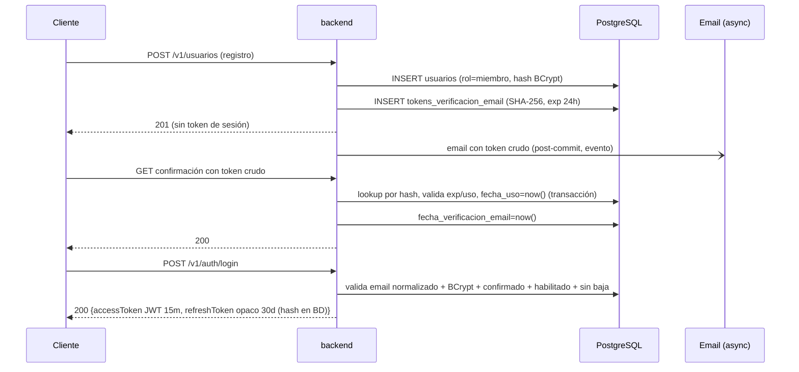
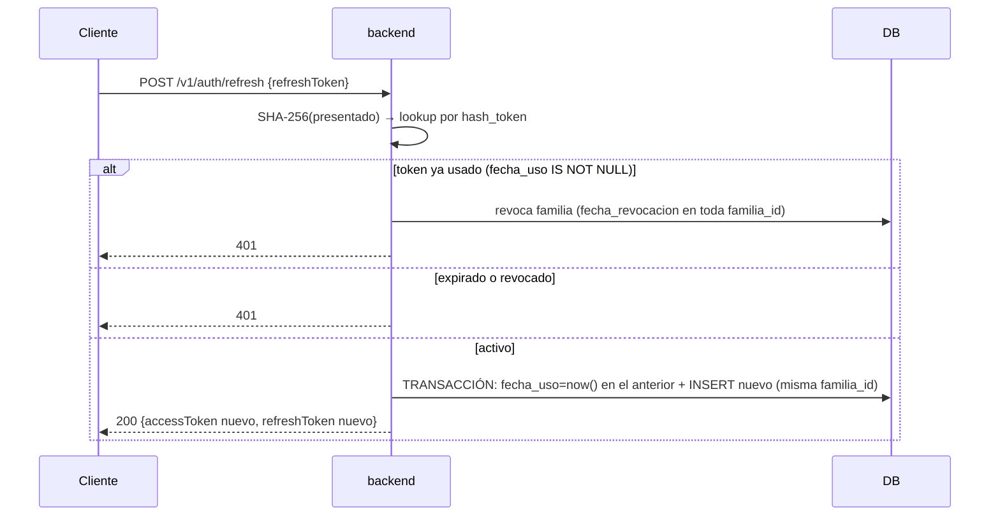

# System Design Document — Uni Market (API)

Documento autónomo para la implementación técnica del backend. Define el *cómo*: arquitectura, módulos, flujos, contrato y estrategia de seguridad.

| Campo | Valor |
|---|---|
| Estado | Borrador |
| Fecha | 2026-10-10 |
| Versión | 1.0 |
| Alcance | Solo este repositorio backend. Web y móvil viven en repos propios (fuera de alcance). |
| Documentos relacionados | `prd.md` (PRD: problema, reglas R1–R15, criterios de aceptación), `database-design.md` (DBDD: esquema, índices, migraciones) |

> **Cómo leer este SDD**: no repite reglas de negocio ni esquema de datos. Referencia al PRD por su identificador (`R1`…`R15`) y al DBDD por su sección. Lo que aquí se marca como **Decisión** es una decisión técnica adoptada; lo marcado como **Pendiente** requiere definición antes de implementar lo que depende de ella.

---

## 1. Propósito, alcance y estado actual

**Propósito.** Diseño técnico de una API REST única bajo `/v1` (contract-first con OpenAPI) que sirve a web y móvil: identidad con roles, catálogo con moderación previa, mensajería comprador–vendedor, notificaciones email transaccionales y panel de administración.

**Estado actual.** No existe código: el repositorio contiene solo `prd.md` y `database-design.md`. Este documento es el paso previo a la implementación; el siguiente es el contrato OpenAPI.

**Fuera de alcance** (heredado del PRD §2 y §7): pagos, tiempo real, push, dominio de correo institucional, edición de mensajes, URLs prefirmadas.

## 2. Contexto y restricciones

| Restricción | Fuente | Consecuencia técnica |
|---|---|---|
| PostgreSQL 18, Flyway forward-only, `pg_trgm` | DBDD §1, §6 | Sin sustitutos en memoria para integración: Testcontainers |
| Spring Boot + Spring Data (JPA) | DBDD §6 | Migraciones gestionadas por Flyway, no por `hbm2ddl` |
| Sin RLS ni triggers; autorización en capa de aplicación | PRD R3, R7; DBDD §1 | `pg_policies` vacío; guards en código testeables |
| JWT 15 min + refresh opaco rotativo 30 días | PRD R12 | Sesión stateless para access, stateful para refresh |
| Una sola fuente de verdad de API (contract-first) | PRD O6 | OpenAPI antes que controladores; cliente generado en CI |
| Repositorio backend exclusivo (Maven) | PRD §5 | Migraciones solo aquí; sin tooling frontend ni generación de cliente JS |
| `fecha_actualizacion` por aplicación, sin triggers | DBDD §1 | JPA auditing (`@PreUpdate`), nunca SQL nativo que lo omita |

## 3. Arquitectura de alto nivel

**Modular monolito en capas.** Un solo despliegue Spring Boot, dividido en módulos de dominio con fronteras explícitas de paquete. Justificación: el dominio es acotado, hay un único equipo y un único despliegue; un microservicio por módulo añadiría coste de red, despliegue y observabilidad sin beneficio (PRD: sin eventos de mensaje, sin pasarela externa). La frontera de módulo existe para poder extraer un módulo después si el volumen lo justifica.

```
                     ┌──────────────────────────────────────────┐
   web / móvil   ───▶ │  Spring Boot (backend)                   │
   (repos externos,   │  ┌────────────────────────────────────┐  │
   cliente generado)  │  │ web/  controllers REST, filtros    │  │
                     │  │ application/  casos de uso, guards │  │
                     │  │ domain/  modelos e invariantes     │  │
                     │  │ infrastructure/ JPA, storage, mail │  │
                     │  └────────────────────────────────────┘  │
                     └───────┬──────────────┬───────────────────┘
                             ▼              ▼
                      PostgreSQL 18    Storage de objetos (S3-compat.)
                      (Flyway V1–V3)   + Resend (email vía API HTTP)
```

**Reglas de dependencia entre capas** (verificables con ArchUnit en CI):

1. `web` → `application` → `domain`. `infrastructure` implementa puertos de `domain`/`application`.
2. Un módulo **no** importa clases internas de otro módulo: solo sus servicios de aplicación expuestos o eventos de dominio.
3. Los controladores no conocen entidades JPA: solo DTOs del contrato.
4. Los predicados de negocio (visibilidad del catálogo, ownership, filtrado de soft-delete) viven en los repositorios como `Specification`s reutilizables — nunca como filtros opcionales del servicio (PRD R4, R7).

## 4. Componentes y responsabilidades

Estructura de paquetes bajo `com.unimarket.api`:

| Módulo | Responsabilidad | Notas |
|---|---|---|
| `shared/` | Errores RFC 9457 (`ProblemDetail`), envelope de paginación, cursor, kernel de seguridad ( extractor JWT, jerarquía de roles ), utilidades de hash de tokens | Sin lógica de negocio |
| `identity/` | Registro, confirmación de email, login, refresh rotativo, logout, reset y cambio de contraseña, perfil, avatar, baja soft-delete, gestión de tokens (3 tablas del DBDD) | Emite y valida JWT |
| `catalog/` | Anuncios del vendedor (crear/editar/visibilidad/vendido/baja), catálogo público con búsqueda y cursor, imágenes (multipart → storage) | Modificación de contenido resetea revisión (R6) |
| `moderation/` | Cola FIFO de pendientes, aprobar/rechazar/retraer con motivo, protección de columnas de moderación, listado admin por estado | El único escritor de `estado_revision`, `revisado_por`, `fecha_revision`, `motivo_rechazo` (R5) |
| `messaging/` | Conversaciones (dedupe por par, idempotencia), mensajes (envío, historial con cursor, no leídos, lista "mis conversaciones") | `vendedor_id` derivado del anuncio; participación verificada en servicio (R9, R10) |
| `admin/` | CRUD de categorías, listado de usuarios filtrable por rol, cambio de rol, habilitar/inhabilitar | Sin borrado físico de usuarios ni `fecha_eliminacion` desde el panel (R15) |
| `notifications/` | Emails de confirmación y reset; envío post-commit asíncrono con backoff; reenvío con cooldown | Nunca revierte el flujo HTTP (PRD §5); adaptador Resend vía API HTTP (prod) y adaptador de log a consola (dev, imprime el token crudo) |
| `media/` | Puerto de almacenamiento de objetos + adaptadores: **filesystem** (dev, raíz configurable `${MEDIA_DIR:~/.uni-market}`, sirve `GET /media/**`) y **S3-compatible → Cloudflare R2** (prod, URL pública `r2.dev` o dominio propio); claves `anuncios/{vendedorId}/{uuid}.{ext}` | Solo expone URLs públicas; las claves jamás salen al wire (R8) |

**Dependencias entre módulos** (única dirección permitida):

- `catalog` necesita `identity` (vendedor autenticado) y `media` (persistencia de imágenes).
- `moderation` opera sobre anuncios de `catalog` (servicio de aplicación de catalog expone operaciones de revisión).
- `messaging` necesita `catalog` (derivar `vendedor_id`, validar anuncio existente) e `identity`.
- `notifications` es un receptor de eventos: nadie lo llama en línea salvo para el reenvío.

## 5. Flujos principales

### 5.1 Registro → confirmación → login



Puntos de cumplimiento: R2 (normalización a minúsculas en registro y login), R11 (hash SHA-256, un activo por propósito — el nuevo insert invalida los previos en la misma transacción), R13 (login con `401` genérico indistinguible), R15 (sin sesión si `habilitado=false` o dado de baja).

### 5.2 Refresh con rotación y detección de reuso (R12)



Logout: revoca por `hash_token` de forma idempotente → siempre `204`.

### 5.3 Publicar → moderar → visibilidad

1. `POST /v1/anuncios` (multipart: campos + hasta 5 imágenes): transacción única — INSERT de la fila y escritura de `imagenes_urls`/`imagenes_paths` pareadas; `estado_revision='pendiente'` siempre, sin excepción de rol (R5); subida al storage antes del commit; si el commit falla, se eliminan los objetos ya subidos (compensación).
2. Moderador obtiene cola `pendiente` FIFO (`fecha_creacion ASC`); aprueba/rechaza/retrae con motivo obligatorio; **predicado anti auto-decisión**: `anuncio.vendedorId == revisor.id → 403`, incluido `admin` (R5).
3. Catálogo: predicado `estado='disponible' AND estado_revision='aprobado'` en `Specification`; detalle no visible → `404` (R4).
4. Edición de contenido por el vendedor: si `estado_revision IN ('aprobado','rechazado')` → reset a `pendiente` + limpieza del trail (R6); reemplazo de imágenes borra los objetos reemplazados.

### 5.4 Mensajería

1. `POST /v1/conversaciones` con `Idempotency-Key`: dedupe natural por UNIQUE `(anuncio_id, comprador_id)`; reuso del par → `200` con la existente; `comprador_id` resuelto del JWT; `vendedor_id` derivado del anuncio (el del cliente se ignora) → auto-conversación imposible (R9). Apertura permitida solo con anuncio visible y vendedor activo (R16).
2. `POST /v1/conversaciones/{id}/mensajes`: verificación de participación (R10); respuesta HTTP como contrato del envío; `fecha_actualizacion` de la conversación se actualiza en la misma transacción.
3. Historial: cursor compuesto hacia atrás, página inicial = más recientes.
4. No leídos: conteo y marcado como acciones explícitas; ningún `GET` muta `leido` (PRD §5).

## 6. Interfaces y contrato

El detalle completo de rutas, cuerpos y códigos vive en el OpenAPI (siguiente entregable). Aquí solo las decisiones estructurales:

**Mapa de recursos** (naming plural en kebab-case, wire `camelCase`):

```
/v1/usuarios                      registro, perfil, avatar, baja
/v1/auth/login|refresh|logout     sesión
/v1/auth/confirmar-email          confirmación
/v1/auth/restablecer-contrasena   solicitud + consumo
/v1/anuncios                      catálogo público + CRUD del vendedor
/v1/categorias                    CRUD (moderador) + lectura pública
/v1/conversaciones                creación/reuso + listado propio
/v1/conversaciones/{id}/mensajes  historial + envío
/v1/moderacion/anuncios           cola + decisiones (moderador)
/v1/admin/usuarios                listado, rol, habilitación (admin)
```

**Errores**: RFC 9457 `application/problem+json`, sin stack traces; split único `400` (problema estructural: JSON inválido, parámetro fuera de dominio/rango) vs `422` (valor que viola una regla de negocio: motivo vacío, auto-conversación, texto en blanco). Un `ExceptionHandler` global por módulo compartido en `shared/`.

**Envelope de colección**: `datos` + `paginacion`. Dos modos:

| Modo | Dónde | Mecanismo |
|---|---|---|
| Cursor opaco | Catálogo e historial de chat | **Cursor compuesto `(fecha_creacion, id)`** codificado en base64; predicado `WHERE (fecha_creacion, id) < (:fc, :id)` (o `>` según dirección). El `id` desempata timestamps iguales y garantiza orden total sin filas saltadas ni duplicadas. |
| Offset + total | Paneles ("mis anuncios", cola de moderación, admin) | `page`/`size` + `total`; default 20, máximo 100. |

Esta definición resuelve el hallazgo de la revisión del PRD (cursor de un solo campo no es estable ante empates). El OpenAPI lo documenta como string opaco: el formato interno puede evolucionar.

**Idempotencia**: `Idempotency-Key` en `POST /v1/conversaciones` es opcional y se acepta como eco en la respuesta; la deduplicación real la impone la UNIQUE `(anuncio_id, comprador_id)` del esquema: cualquier reintento con el mismo par obtiene la misma conversación con `200`. No se almacena la clave (no hay tabla para ello; el DBDD no la define).

**Validación**: Bean Validation en DTOs en espejo al contrato (`@Size`, `@NotNull`, enum de dominio); las reglas que exigen consulta (email único, categoría existente, participación) son de servicio. El CHECK de BD es la última línea de defensa, mapeado a `422`/`409` según el caso (DBDD §5).

## 7. Datos

Resumen y referencia. **Fuente de verdad: `database-design.md`** (8 tablas, 16 índices, CHECKs, FKs, migraciones V1–V3). Decisiones de integración con el código:

| Tema | Decisión |
|---|---|
| Mapeo OR/M | Hibernate con `PhysicalNamingStrategy` snake_case; entidades sin `@Column` repetido |
| Auditoría | `@CreationTimestamp`/`@UpdateTimestamp` equivalente gestionado por la capa de aplicación; `mensajes` sin `fecha_actualizacion` (inmutable) |
| Enumeraciones de dominio | Enums Java (`Rol`, `EstadoAnuncio`, `EstadoRevision`) con conversor `AttributeConverter`; el CHECK de BD respalda el dominio cerrado |
| `jsonb` (imágenes) | Tipos Hypersistence o conversor propio; escritura de ambos arrays en la misma transacción que la fila (R8) |
| Búsqueda `ILIKE` | Repositorio con `ILIKE` + escape de `%`, `_`, `\` (PRD §5); trigram lo acelera, la corrección semántica la da el escape |
| Migraciones | Solo en este repositorio, Flyway en arranque; `V1__esquema_base.sql`, `V2__datos_categorias.sql`, `V3__tokens_identidad.sql`; requiere el módulo `flyway-database-postgresql` (Flyway 12 ya no incluye el soporte de motor PostgreSQL) |

**Correcciones aplicadas al DBDD en esta revisión (2026-10-10)**: índices parciales `ux_tokens_*_activos` (16 índices en total), `id` como desempate en `idx_anuncios_publicacion` e `idx_mensajes_conversacion_creado`, índices compuestos de participantes `(comprador_id/vendedor_id, fecha_actualizacion DESC)` para "mis conversaciones" (reemplazan los de una columna, que quedaban cubiertos como prefijo izquierdo), CHECKs de consistencia del trail de moderación y de longitud de `icono`, y `NO ACTION` explícito en las FK de tokens.

**Sin pendientes de esquema.**

## 8. Seguridad (estrategia técnica)

| Aspecto | Decisión |
|---|---|
| Hash de contraseñas | BCrypt (fuerza estándar de la librería), mínimo 8 caracteres validado en DTO (NIST 800-63B, sin composición — R11) |
| Access token | JWT firmado **HS256** con secreto externalizado; `sub` = `usuarios.id`, claim `roles`. Justificación: un único servicio valida y emite; RS256 solo aportaría beneficio con múltiples verificadores. Pendiente de revisión si aparecen otros servicios |
| Validación JWT | `spring-security-oauth2-resource-server` (NimbusJwtDecoder) con filtro propio que carga el estado vigente del usuario (rol, `habilitado`, baja) desde la BD en cada request — el claim es optimización, la BD es autoridad (R3, R14: el cambio de rol no espera expiración para surtir efecto en la autorización) |
| Jerarquía de roles | `RoleHierarchy` de Spring Security (`admin` ⊃ `moderador` ⊃ `miembro`) + `@PreAuthorize` por endpoint; casos permitidos y denegados cubiertos por tests (PRD §6) |
| Ownership | Predicado de propiedad en el repositorio (las queries de "mis anuncios" llevan `vendedor_id = :sub` incorporado) + verificación en servicio antes de mutar (R7, defensa en profundidad) |
| Anti auto-decisión | Regla de servicio explícita en `moderation` y `admin`: `403` si el actor opera sobre su propio recurso (R5, R14) |
| Tokens persistidos | Siempre SHA-256 del valor crudo; consumo transaccional con `fecha_uso` (R11) |
| No-enumeración | Reset: mismo status/cuerpo siempre; login: `401` genérico único; detalle de anuncio no visible: `404` (R4, R13) |
| Rate limiting | Filtro de límite por IP+email en el reset (obligatorio, R13) y en login/registro (recomendado — resuelve Q1 como decisión por defecto, revocable por configuración) |
|Cabeceras y CORS | Orígenes de web/móvil por configuración; cabeceras de seguridad por defecto de Spring Security; sin HTML renderizado (los clientes no confían en contenido de usuario) |

## 9. Calidad y pruebas

| Nivel | Qué | Herramienta |
|---|---|---|
| Unitario | Lógica de dominio: resets de revisión, validación de participación, jerarquía de roles; reglas numéricas de límites con `@ParameterizedTest` | JUnit 5 + Mockito (`@Mock`/`@InjectMocks`) + **AssertJ**, sin Spring |
| Slice web | Controladores: códigos HTTP, validación de DTOs, errores RFC 9457 | `@WebMvcTest` con **`MockMvcTester`** (aserciones AssertJ); `@MockitoBean` para dependencias (no `@MockBean`, deprecado en Boot 4) |
| Slice datos | Repositorios y las decisiones D4/D5: cursor compuesto `(fecha_creacion, id)`, `Specification`s de visibilidad/ownership (R4, R7), `ILIKE` con trigram real, mapeo de violaciones de CHECK a errores | `@DataJpaTest` + **Testcontainers (PostgreSQL real)** con Flyway V1–V3 aplicadas |
| Slice cliente HTTP | Adaptador de **Resend**: petición HTTP formada y manejo de fallo del proveedor sin tocar Resend (D12) | `@RestClientTest` |
| Slice serialización | Espejo wire `camelCase` ↔ columnas `snake_case`; payloads de errores `application/problem+json` | `@JsonTest` |
| Integración | Flujos completos contra **PostgreSQL real** (nada en memoria — PRD §6): auth con rotación y reuso, moderación end-to-end, catálogo, chat, guards permitido/denegado | `@SpringBootTest` con contexto mínimo + Testcontainers; una instancia de PostgreSQL compartida entre clases (context caching) para no pagar arranque por suite |
| Contrato | Guardas del contrato dentro de `mvn verify` (validez estructural + `$ref`s con swagger-parser; claves YAML duplicadas prohibidas con SnakeYAML estricto). La detección de cambios incompatibles se añadirá como guarda Java (p. ej. `openapi-diff`) cuando exista primera release del contrato | swagger-parser + SnakeYAML estricto (deps de test, sin Node) |
| Cobertura | Gate CI: núcleo/dominio ≥ 80 % (los gates de UI viven en los repos de clientes). **Hoy solo reporta**: se activa con el módulo `identity`, cuando exista código de dominio evaluable | JaCoCo |

**Organización de la suite** (convención de los skills `java-junit` / `java-springboot-testing`): clases con sufijo `Test` y patrón AAA; `@Nested` agrupando por caso de uso; `@DisplayName` descriptivo en español; `@Tag("fast")` para la suite sin Testcontainers en el ciclo rápido de CI; datos de prueba complejos (anuncios con imágenes pareadas, usuarios por rol) generados con **Instancio**; un solo caso de comportamiento por test, independiente y en cualquier orden.

Cada guard de autorización tiene al menos un caso permitido y uno denegado (criterio de aceptación del PRD §8).

## 10. Despliegue y operación

| Tema | Decisión |
|---|---|
| Configuración | Externalizada (perfiles Spring): DSN de BD, secreto JWT, API key de Resend, storage (`MEDIA_DIR` en dev / credenciales R2 en prod, D14), TTLs de token, cooldown de reenvío, límites de imagen — una sola fuente de configuración de límites (R8) |
| Respaldo | Backup diario automatizado de PostgreSQL con retención de 7 días (Q4, 2026-10-10) |
| Emails | Evento transaccional `@TransactionalEventListener(AFTER_COMMIT)` + cola en memoria con backoff y máximo de intentos; un fallo del proveedor nunca revierte el flujo HTTP (PRD §5). El log de entrega son logs estructurados de aplicación con `traceId` — sin tabla de auditoría (N2 resuelta, 2026-10-10). Proveedor: Resend vía API HTTP (prod); adaptador de log a consola en dev (D12) |
| Compensación de storage | Subida de imágenes antes del commit; borrado de objetos huérfanos en rollback de la transacción de creación |
| Observabilidad | Logs estructurados con `traceId`; métricas básicas de arranque de Spring. SLO diferidos a pre-producción con latencias medidas (Q2 resuelta, 2026-10-10) |
| CI | Maven: build + tests + validación del contrato (guardas Java en tests); gate de cobertura de dominio (sin path filters, un solo repositorio) |

## 11. Decisiones técnicas y trade-offs (resumen ADR)

| # | Decisión | Alternativa descartada | Por qué |
|---|---|---|---|
| D1 | Modular monolito en capas con fronteras de paquete | Microservicios | Un despliegue, dominio acotado, sin eventos entre servicios; extraer un módulo después es posible por las fronteras |
| D2 | Access JWT HS256 + refresh opaco rotativo hasheado | Sesiones server-side; JWT con refresh también JWT | El JWT corto evita lookup por request; el refresh opaco (hash) permite rotación y detección de reuso sin exponer estructura |
| D3 | Cargar estado de usuario desde BD en cada request autenticado | Confiar solo en el claim del JWT | El rol debe reflejarse de inmediato tras cambio de rol (R14) y la baja/habilitación debe cortar sesión (R15); el claim solo ahorra un JOIN trivial |
| D4 | Cursor compuesto `(fecha_creacion, id)` | Cursor de un solo campo; offset en catálogo | Orden total estable ante empates y ante inserciones (O3); offset en catálogo paginaría mal con inserciones concurrentes |
| D5 | Predicados de negocio como `Specification` en repositorio | Filtros en servicio / RLS | Reutilizables, testeables, y "mis anuncios" no puede devolver filas ajenas aunque se manipule el filtro (R7); RLS movería reglas de negocio versionadas en código a la BD, contra el PRD |
| D6 | `Idempotency-Key` opcional sin almacenamiento; dedupe por UNIQUE natural | Tabla de claves de idempotencia | La UNIQUE `(anuncio_id, comprador_id)` ya garantiza el resultado idempotente; una tabla de claves añade complejidad sin necesidad en este flujo |
| D7 | Subida multipart directa a través de la API (sin URLs prefirmadas) | Pre-signed URLs | Decisión del PRD §7; simplifica el cliente y centraliza validación de tipo/tamaño |
| D8 | Evento AFTER_COMMIT para email | Envío síncrono; outbox persistente | El PRD exige que el fallo del proveedor nunca revierta el HTTP; outbox persistente sería sobre-ingeniería sin requisito de entrega garantizada (pendiente Q del log de entrega) |
| D9 | `Specification`s + escape manual para `ILIKE` | FTS de Postgres (`tsvector`) | El requisito es búsqueda por texto libre simple con trigram; FTS añade diccionario y mantenimiento sin beneficio probado en este volumen |
| D10 | MapStruct para DTO ↔ contrato | Mapeo manual | Volumen de DTOs alto y contract-first; reduce errores de espejo wire/columna |
| D11 | Stack fijo: Java 21 (LTS), Spring Boot 4.1 (línea 4.x vigente, sobre Spring Framework 7 / Security 7), Spring MVC, Maven, PostgreSQL 18, OpenAPI 3.1; repositorio backend exclusivo | Java 17/25, Boot 3.5, Gradle, monorepo | Generación estable vigente al iniciar (2026-10). Nota: ni PostgreSQL ni OpenAPI publican ediciones "LTS": son sus versiones mayores actuales (PG 18 con 5 años de soporte) |
| D12 | Email vía Resend (API HTTP) en prod; adaptador de log a consola en dev que imprime el token crudo | SDK/SMTP de Resend; Mailpit | Resend no ofrece sandbox real ni SDK oficial Java; el adaptador de log permite completar confirmación/reset en dev y mockear el puerto en tests sin dependencias externas |
| D13 | Validación del contrato OpenAPI 100 % Java dentro de `mvn verify` (swagger-parser + guard SnakeYAML estricto); cero tooling Node/JS en repo y CI | Spectral/oasdiff en CI; `openapi-generator-maven-plugin` | Decisión del propietario: nada de npm/JS. El plugin de openapi-generator NO expone goal `validate` (solo `generate`/`help`); swagger-parser valida de verdad y el guard estricto tapa el agujero de claves duplicadas que los parsers Java ignoran. Un comando local reproduce el CI |
| D14 | Media: adaptador **filesystem en dev** (raíz `${MEDIA_DIR:~/.uni-market}` — datos de usuario, no configuración; OS-independiente vía `user.home`) y adaptador **S3-compatible apuntando a Cloudflare R2 en prod** (URL pública `r2.dev`; un dominio propio la reemplaza después) | MinIO local en dev; uploads dentro del repo; URLs prefirmadas | Cero dependencias para correr en dev (docker-less); detrás del puerto `AlmacenObjetos` el cambio dev→prod es un bean + propiedades. R2 encaja sin costo y con API S3. `~/.config` rechazado: es para configuración, no para datos generados |

## 12. Riesgos y preguntas abiertas

**Heredadas del PRD**: Q1 y Q4 resueltas (rate limiting por defecto en §8; backup diario con retención de 7 días, §10); Q2 deferida a pre-producción con latencias reales; Q3 sin SLA (fuera de alcance); Q5 resuelta — dueño de producto = propietario del proyecto.

**Nuevas de este diseño**:

| # | Riesgo / pendiente | Impacto | Cuándo bloquea |
|---|---|---|---|
| N1 | Correcciones del DBDD (índices de tokens, `NO ACTION` explícito, CHECKs de trail e `icono`) | — | **Resuelto (2026-10-10)**: aplicadas al DBDD |
| N2 | "Log de entrega" de emails sin definir (logs vs tabla) | Menor | **Resuelto (2026-10-10)**: logs estructurados, sin tabla de auditoría |
| N3 | Mecanismo exacto del rate limiter (en memoria vs distribuido) | Menor | Solo si se despliegan varias instancias; en un despliegue único, en memoria basta |
| N4 | Documentación del cursor compuesto en el PRD (dice "cursor opaco estable"; la implementación es compuesta) | Cosmético | Al redactar el OpenAPI |

## 13. Documentos relacionados

- `prd.md` — PRD: reglas R1–R15, criterios de aceptación, preguntas Q1–Q5.
- `database-design.md` — DBDD: esquema, índices, CHECKs, migraciones.
- *Pendiente*: `openapi.yaml` — contrato `/v1` como fuente de verdad para el cliente generado (siguiente entregable).
